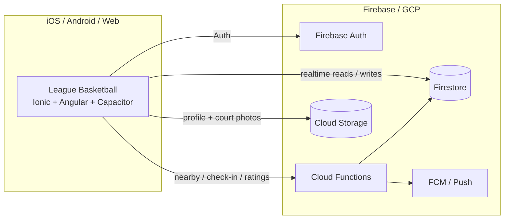

# League For Basketball — From Concept to App Store (Showcase)

A location-based basketball social app I designed, built, and shipped on my own — part of the **League Mobile Apps** sports suite that began around **2015**.

This repository is portfolio / archival material. The apps were released on the **iOS App Store and Google Play**, but are **no longer in circulation**. The point of this showcase is simple: I have been taking mobile products from concept → design → cloud backend → store release for a long time.

Snippets under [`snippets/`](./snippets) are **illustrative only** — they are not a working product checkout. The Cap8 client excerpts reflect a later modernization pass on the same product family.

---

## Why this exists (the story)

My name is Sheldon Bradley. I'm a basketball fan and player, and a developer by day. I grew up in Memphis, TN, where basketball is king. Someone donated a portable basketball goal to the kids in my neighborhood, and we played on that goal like there was no tomorrow. When we wanted better competition, we took the goal apart and walked it to other neighborhoods. Probably not the smartest thing to do — but I miss those days of competing just to be known as the best on the block.

That was my whole motivation for creating **League For Basketball**. I wanted young people (and weekend warriors) to get out, compete, discover new places, and interact with one another using the tools we have today. I spent about a year designing and developing the app, and League For Basketball became a real product on the App Store.

There wasn't a basketball app that connected streetball, AAU, high school, college, semi-pro, and pro players — men and women — around the reasons they actually play: compete against the best you can find, sharpen your game, and make a name for yourself among your peers. League For Basketball brought that together through mobile technology, geo-location, and social media.

That basketball app was the flagship of a broader **League Mobile Apps** brand — basketball, soccer, volleyball, lacrosse, and tennis — same product idea, sport by sport.

  
  &nbsp;
  

---

## What this showcase proves

| Claim | Evidence in this repo |
|-------|------------------------|
| Solo founder / builder | Product site, brand pages, and engineering excerpts I authored |
| Multi-year evolution | ~2015 marketing site → store releases → later Cap8 modernization snippets |
| Full product lifecycle | Concept, branding, web presence, mobile client, Firebase backend, App Store / Play |
| Sports suite, not a one-off | Archived site lists Basketball, Soccer, Volleyball, Lacrosse, Tennis |
| No longer live | Archival framing only — not a current consumer product |

---

## What you will find here

| Path | Contents |
|------|----------|
| [`site-archive/`](./site-archive) | 2015 League Mobile Apps marketing site (`leaguemobileapps.com` era) |
| [`MEDIA/`](./MEDIA) | Basketball brand / feature stills pulled from that site |
| [`snippets/`](./snippets) | Sanitized Cap8 + Cloud Functions architecture excerpts |
| [`ARCHITECTURE.md`](./ARCHITECTURE.md) | Geo check-in / ratings / Firestore design walkthrough |
| [`TIMELINE.md`](./TIMELINE.md) | Dated filesystem receipts from the archive |
| [`DISCLAIMER.md`](./DISCLAIMER.md) | Archival context — apps not currently in circulation |

Open the historic site locally via [`site-archive/index.html`](./site-archive/index.html) or the basketball product page [`site-archive/basketball.html`](./site-archive/basketball.html). The original About / founder page is [`site-archive/about.html`](./site-archive/about.html).

---

## The League Mobile Apps suite (~2015)

From the archived homepage — each title was positioned as free on **iOS and Android**:

1. **League For Basketball** — flagship; courts, check-in, peer skill ratings
2. **League For Soccer**
3. **League For Volleyball**
4. **League For Lacrosse**
5. **League For Tennis**

Same core idea across sports: geo-location + peer ratings + social competition (“get your stats up”).

---

## Architecture (engineering slice)

Later stack shape for the basketball line (modern Cap8 rebuild + Cloud Functions):

See [ARCHITECTURE.md](./ARCHITECTURE.md) for proximity check-in, live occupancy, rating aggregation, and dual auto-checkout.

### Design principles

| Principle | How it shows up |
|-----------|-----------------|
| Proximity as a gate | Check-in only after server-side distance verification against the court |
| Unique I/O identity | `userId-locationId` keys drive create-or-update on `Locations_IO` |
| Live occupancy | `LiveUsers_List` + player counts updated with check-in/out |
| Rating create-or-update | Existing relationship updates in place; otherwise a new rating doc |
| Stats as derived data | Aggregated skill averages + badges written after each rating |
| Dual auto-checkout | Client geo drift + scheduled Cloud Function cron for stale sessions |

---

## Stack (later modernization pass)

| Layer | Tech |
|-------|------|
| Mobile | Angular 22, Ionic 9, Capacitor 8, Firebase JS SDK 12 |
| State | NGXS |
| Backend | Firebase Cloud Functions, Firestore, Cloud Storage |
| Geo | Bounding-box prefilter → distance gate; optional Places seeding |
| Push | FCM via Cloud Functions + Capacitor Push |
| Historic web | Bootstrap 3 marketing site (archived under `site-archive/`) |

---

## Code highlights

Sanitized excerpts live under [`snippets/`](./snippets).

| Area | What to look at |
|------|-----------------|
| Endpoint surface | `snippets/ionic/01-endpoint-surface.ts` |
| Check-in proximity flow | `snippets/ionic/02-checkin-proximity-flow.ts` |
| Locations NGXS state | `snippets/ionic/03-locations-ngxs-state.ts` |
| Client auto-checkout | `snippets/ionic/04-client-auto-checkout.ts` |
| Function exports | `snippets/cloud/01-function-exports.ts` |
| Firestore paths | `snippets/cloud/02-firestore-paths.ts` |
| Nearby locations query | `snippets/cloud/03-nearby-locations-query.ts` |
| Check-in permission | `snippets/cloud/04-checkin-permission.ts` |
| Rating aggregation | `snippets/cloud/05-rating-aggregation.ts` |

---

## Media

Brand and feature stills from the 2015 site:

- [`MEDIA/leagueBasketballSplash.png`](./MEDIA/leagueBasketballSplash.png)
- [`MEDIA/app-brandLogo-basketball.png`](./MEDIA/app-brandLogo-basketball.png)
- [`MEDIA/basketballFeature1.png`](./MEDIA/basketballFeature1.png)
- [`MEDIA/basketballFeature2.png`](./MEDIA/basketballFeature2.png)

Additional store-demo video can be dropped into [`MEDIA/`](./MEDIA) later.

---
