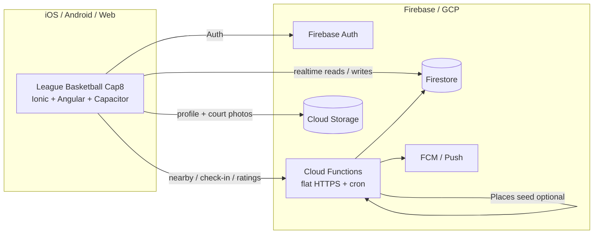

# League Basketball — Location Social Platform (Showcase)

Ionic / Angular / Capacitor mobile client + Firebase Cloud Functions for a location-based basketball social app.

This repository demonstrates **software architecture and engineering practice** — map discovery, proximity-gated check-in, live court occupancy, peer ratings, and push notifications. Production credentials, API keys, and proprietary calibrations are intentionally omitted.

Snippets under [`snippets/`](./snippets) are **illustrative only** — they are not a working product checkout.

---

## What this system is

A geo-social sports stack:

1. **Mobile app** (Ionic 9 + Angular 22 + Capacitor 8) discovers nearby courts, manages check-in/out, ratings, rankings, and profiles.
2. **Cloud Functions** enforce proximity, maintain location I/O history, aggregate skill ratings into stats/badges, and fan out push notifications.
3. **Firestore** holds user profiles, live occupancy lists, rating relationships, bookmarks, and in-app messages.
4. **Scheduled hygiene** auto-checks out stale sessions so courts do not show ghost occupancy.

The Cap8 client is a modern rebuild of the legacy League Basketball app against the same Firebase project family, with flat Cloud Function names (not REST path prefixes).

---

## Architecture

See [ARCHITECTURE.md](./ARCHITECTURE.md) for a deeper walkthrough.

### Design principles

| Principle | How it shows up |
|-----------|-----------------|
| Proximity as a gate | Check-in only after server-side distance verification against the court |
| Unique I/O identity | `userId-locationId` keys drive create-or-update on `Locations_IO` |
| Live occupancy | `LiveUsers_List` + player counts updated with check-in/out |
| Rating create-or-update | Existing relationship updates in place; otherwise a new rating doc |
| Stats as derived data | Aggregated skill averages + badges written after each rating |
| Dual auto-checkout | Client geo drift + scheduled Cloud Function cron for stale sessions |
| Flat function surface | Cap8 calls named HTTPS functions (vs Core’s `/rest/api/v1` style) |
| NGXS for map UI | Locations/markers/panel/add-mode kept out of component spaghetti |

---

## Stack

| Layer | Tech |
|-------|------|
| Mobile | Angular 22, Ionic 9, Capacitor 8, Firebase JS SDK 12 (modular) |
| State | NGXS |
| i18n | ngx-translate |
| Backend | Firebase Cloud Functions (Node/TypeScript), Firestore, Cloud Storage |
| Geo | Bounding-box prefilter → haversine / distance gate; optional Places seeding |
| Push | FCM via Cloud Functions + Capacitor Push |

---

## Platform capabilities

### Mobile client

- Auth-gated tabs + lazy-loaded location info / ratings routes
- Nearby court discovery and map markers
- Proximity-gated check-in / check-out with live user list updates
- Client-side auto-checkout when the device leaves the court radius
- Peer skill ratings, personal stats, rankings
- Bookmarks, in-app messages, camera uploads, social share

### Cloud

- Nearby location query (`userNearbyLocations`)
- New-location distance verification
- Optional Places seeding when the local catalog is sparse
- Check-in permission + location I/O history
- Scheduled auto-checkout for stale check-ins
- Rating create/update + mystats aggregation
- Location occupancy push fan-out
- Email verification / change helpers

---

## Code highlights

Sanitized excerpts live under [`snippets/`](./snippets).

| Area | What to look at |
|------|-----------------|
| Endpoint surface | `snippets/ionic/01-endpoint-surface.ts` |
| Check-in proximity flow | `snippets/ionic/02-checkin-proximity-flow.ts` |
| Locations NGXS state | `snippets/ionic/03-locations-ngxs-state.ts` |
| Client auto-checkout | `snippets/ionic/04-client-auto-checkout.ts` |
| Function exports | `snippets/cloud/01-function-exports.ts` |
| Firestore paths | `snippets/cloud/02-firestore-paths.ts` |
| Nearby locations query | `snippets/cloud/03-nearby-locations-query.ts` |
| Check-in permission | `snippets/cloud/04-checkin-permission.ts` |
| Rating aggregation | `snippets/cloud/05-rating-aggregation.ts` |

---

## Media

Demo media for map discovery, check-in, and ratings can be added under [`MEDIA/`](./MEDIA).

---
