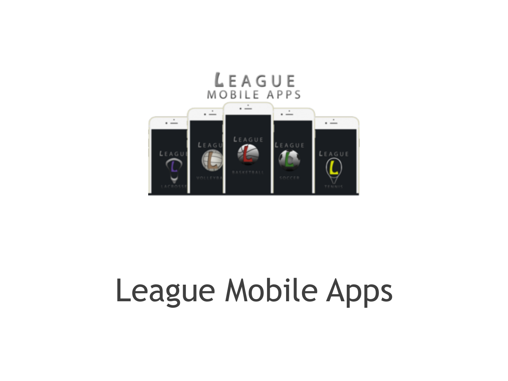
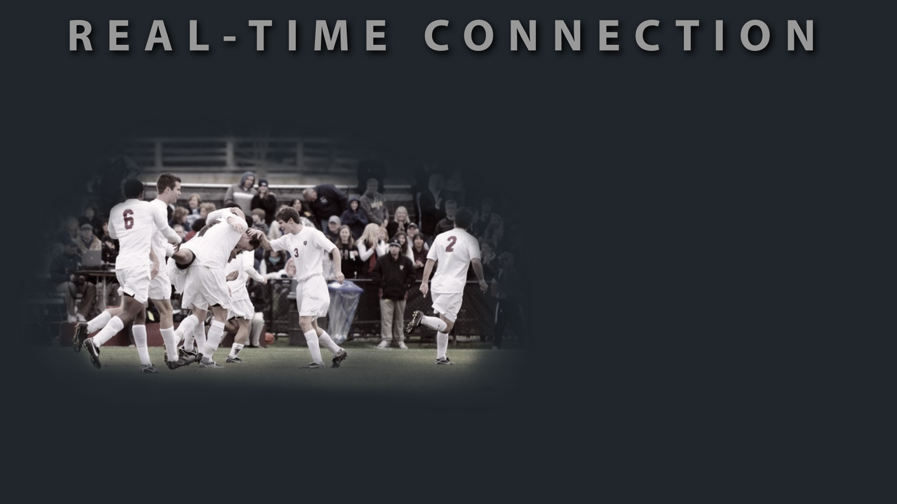
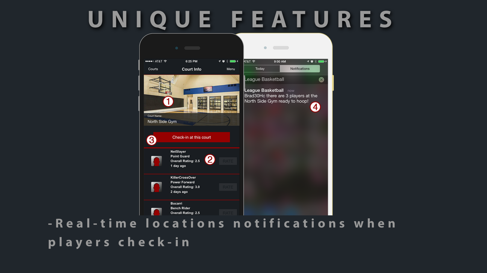
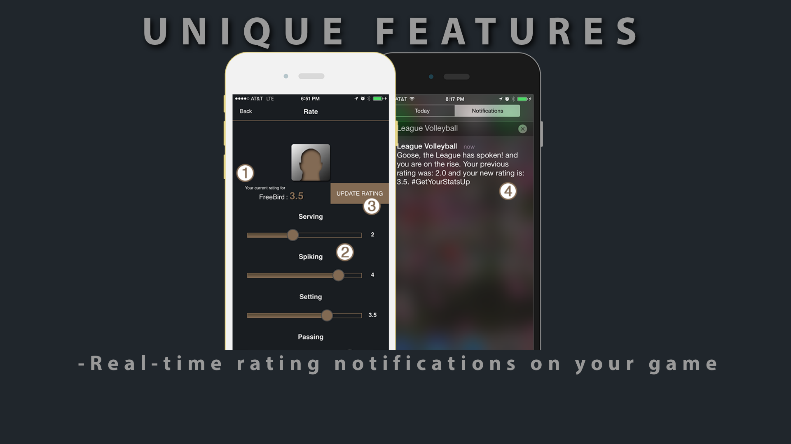
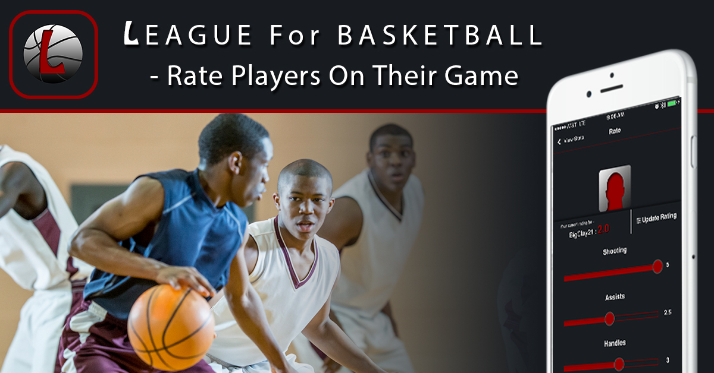
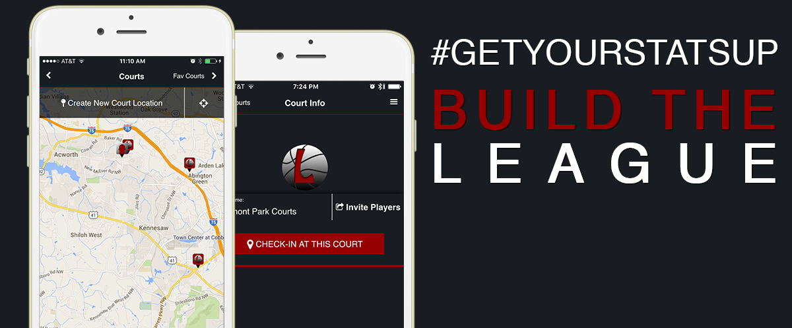
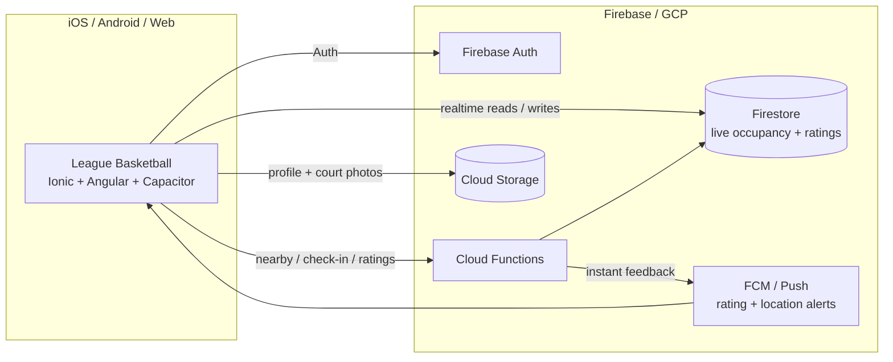

# League Mobile Apps — Real-Time Sports Social Platform (Showcase)

A multi-sport realtime social platform I designed, built, marketed, and shipped on my own — **League Mobile Apps** — active from around **2015 through 2019**. League For Basketball was the flagship; the same product idea shipped across basketball, soccer, volleyball, lacrosse, and tennis.

This is portfolio / archival material. The apps were released on the **iOS App Store and Google Play**, remained in market through **2019**, and are **no longer in circulation**. The point of this showcase: I have taken mobile products from concept → realtime backend → brand system → ambassador program → store release for a long time.

Snippets under [`snippets/`](./snippets) are **illustrative only**. Cap8 excerpts reflect a later modernization pass on the basketball line of the same product family.

---

## Why this exists (the story)

My name is Sheldon Bradley. I'm a basketball fan and player, and a developer by day. I grew up in Memphis, TN, where basketball is king. Someone donated a portable basketball goal to the kids in my neighborhood, and we played on that goal like there was no tomorrow. When we wanted better competition, we took the goal apart and walked it to other neighborhoods. Probably not the smartest thing to do — but I miss those days of competing just to be known as the best on the block.

That was my whole motivation for creating **League For Basketball**. I wanted young people (and weekend warriors) to get out, compete, discover new places, and interact with one another using the tools we have today. I spent about a year designing and developing the app, and League For Basketball became a real product on the App Store.

There wasn't a basketball app that connected streetball, AAU, high school, college, semi-pro, and pro players — men and women — around the reasons they actually play: compete against the best you can find, sharpen your game, and make a name for yourself among your peers. League For Basketball brought that together through mobile technology, geo-location, and social media.

That basketball app was the flagship of a broader **League Mobile Apps** brand — basketball, soccer, volleyball, lacrosse, and tennis — same realtime product idea, sport by sport.

  

---

## The headline: it was a real-time platform

League was not a static “find a court” directory. The product was built so athletes got **instant feedback** from the live field:

| What happened | What you saw / felt immediately |
|---------------|----------------------------------|
| Someone checked in at your court | Live player count + optional push (“players are here”) |
| You checked in | You appeared on that location’s live list for others |
| Someone rated your game | Stats / badge update + rating push (`#GetYourStatsUp`) |
| You rated a peer | Their mystats recalculated; relationship created or updated |
| New nearby activity | Location / in-app messages kept you opening the app |

That realtime loop — **congregate → compete → compare** — was the product thesis and the commercial thesis. Engagement frequency was the inventory for brand and advertising opportunities.

  

  
  &nbsp;
  

See [BUSINESS.md](./BUSINESS.md) for the full go-to-market / monetization write-up, and [ARCHITECTURE.md](./ARCHITECTURE.md) for how check-in, occupancy, ratings, and push were engineered.

---

## Marketing was first-class — including brand ambassadors

This was not “ship code and hope.” The 2016 pitch and opportunity decks treated League as a brand platform with clear revenue paths:

- **Realtime engagement → ad / notification inventory** (mobile ad networks, custom notification ads, custom event campaigns)
- **Geo + moment targeting** for sports businesses around tournaments, camps, tryouts, and known athlete hangouts
- **Grassroots athlete endorsements** with formal contracts, campaign hashtag `#GetYourStatsUp`, SMS download CTAs, and League gear
- **Finished social creatives** across Facebook, Instagram, and Twitter for each sport
- **In-app message campaigns** driving check-in, create-location, and invite behaviors

Brand ambassadors were real: signed Endorsement Agreements through Persistence Multimedia Productions LLC required ambassadors to use the realtime product (profiles, check-ins, location creation, rating shares) while promoting the apps.

  
  &nbsp;
  

Details + receipts: [BUSINESS.md](./BUSINESS.md) · [`receipts/`](./receipts)

---

## What this showcase proves

| Claim | Evidence in this repo |
|-------|------------------------|
| Realtime social sports product | Opportunity deck stills, architecture, push/rating/check-in snippets |
| Instant user feedback loops | Live occupancy, rating notifications, in-app messages |
| Solo founder / builder | Product site, pitch (Founder/Developer), engineering excerpts |
| Serious marketing system | Pitch GTM slides, social ads, in-app creatives, ambassador template |
| Brand / advertising opportunity | Sales-channel slides + contextual notification inventory thesis |
| Brand ambassadors executed | Endorsement Agreement template + 2016 program evidence (signed PII withheld) |
| Multi-year evolution | ~2015 launch → 2016 GTM peak materials → active through 2019 → later Cap8 snippets |
| Store-shipped suite | iOS + Android positioning on archived site; five sports; market presence into 2019 |
| No longer live | Suite wound down after 2019 — archival framing only |

---

## What you will find here

| Path | Contents |
|------|----------|
| [`site-archive/`](./site-archive) | 2015 League Mobile Apps marketing site |
| [`receipts/`](./receipts) | Pitch PDF, endorsement template, page previews, ad samples |
| [`MEDIA/`](./MEDIA) | Brand, suite, realtime, and ad stills |
| [`BUSINESS.md`](./BUSINESS.md) | Realtime GTM, monetization, ambassador program |
| [`snippets/`](./snippets) | Sanitized Cap8 + Cloud Functions architecture excerpts |
| [`ARCHITECTURE.md`](./ARCHITECTURE.md) | Engineering: geo check-in, occupancy, ratings, push |
| [`TIMELINE.md`](./TIMELINE.md) | Dated filesystem receipts |
| [`DISCLAIMER.md`](./DISCLAIMER.md) | Archival context — apps not currently in circulation |

---

## The League Mobile Apps suite (~2015–2019)

Each title was positioned free on **iOS and Android**:

1. **League For Basketball** — flagship; courts, live check-in, peer skill ratings
2. **League For Soccer**
3. **League For Volleyball**
4. **League For Lacrosse**
5. **League For Tennis**

Shared idea: geo-location + **realtime** peer competition + social proof (“get your stats up”), offered in English, Spanish, and French.

---

## Architecture (engineering slice)

Later stack shape for the basketball line (modern Cap8 rebuild + Cloud Functions) — the machinery behind the realtime product:

### Design principles (product + engineering)

| Principle | How it shows up |
|-----------|-----------------|
| Realtime first | Live `LiveUsers_List`, rating rollups, FCM fan-out on occupancy/rating changes |
| Instant feedback | Check-in visible to peers; rating → mystats → push |
| Proximity as a gate | Server-side distance verification before check-in |
| Unique I/O identity | `userId-locationId` create-or-update on `Locations_IO` |
| Dual auto-checkout | Client geo drift + cron so live counts stay honest |
| Engagement = inventory | Notifications / in-app messages designed for frequency + brand CTAs |

---

## Stack (later modernization pass)

| Layer | Tech |
|-------|------|
| Mobile | Angular 22, Ionic 9, Capacitor 8, Firebase JS SDK 12 |
| State | NGXS |
| Backend | Firebase Cloud Functions, Firestore, Cloud Storage |
| Realtime feedback | Firestore listeners + FCM (location + rating pushes) |
| Geo | Bounding-box prefilter → distance gate; optional Places seeding |
| Historic web / GTM | Bootstrap marketing site + 2016 pitch / ads / ambassadors |

---

## Code highlights

Sanitized excerpts live under [`snippets/`](./snippets).

| Area | What to look at |
|------|-----------------|
| Endpoint surface | `snippets/ionic/01-endpoint-surface.ts` |
| Check-in proximity flow | `snippets/ionic/02-checkin-proximity-flow.ts` |
| Locations NGXS state | `snippets/ionic/03-locations-ngxs-state.ts` |
| Client auto-checkout | `snippets/ionic/04-client-auto-checkout.ts` |
| Function exports | `snippets/cloud/01-function-exports.ts` |
| Firestore paths | `snippets/cloud/02-firestore-paths.ts` |
| Nearby locations query | `snippets/cloud/03-nearby-locations-query.ts` |
| Check-in permission | `snippets/cloud/04-checkin-permission.ts` |
| Rating aggregation | `snippets/cloud/05-rating-aggregation.ts` |

---

## Media

- Suite pitch cover — [`MEDIA/suite-pitch-cover.png`](./MEDIA/suite-pitch-cover.png)
- Realtime opportunity stills — [`MEDIA/opportunity-realtime-*.png`](./MEDIA)
- Competitive “real-time” pitch slide — [`MEDIA/pitch-competitive-realtime.png`](./MEDIA/pitch-competitive-realtime.png)
- Social + in-app creatives — [`MEDIA/ad-facebook-basketball.jpg`](./MEDIA/ad-facebook-basketball.jpg), [`MEDIA/inapp-checkin-message-basketball.png`](./MEDIA/inapp-checkin-message-basketball.png)
- Brand stills from the 2015 site — splash / logo / feature shots under [`MEDIA/`](./MEDIA)

---
